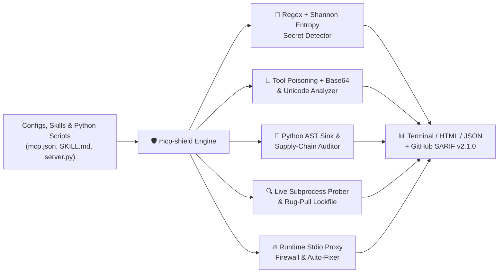

# 🛡️ mcp-shield

**AI Agent and MCP Security Scanner. Protects local development environments by auditing Model Context Protocol configs, decoding hidden prompt injections, checking Python AST for dangerous execution, and enforcing supply chain hardening.**

[](https://www.python.org/downloads/)
[](LICENSE)
[](#)
[](#)
[](https://coderabbit.ai)

Developers connect dozens of Model Context Protocol (MCP) servers and `SKILL.md` files to local AI coding assistants without auditing what those tools can access. **`mcp-shield`** scans, probes, hardens, and firewalls your MCP ecosystem in under a second.

---

## ✨ Architecture & Capabilities



---

## 🚀 Quickstart

### 1. Run the Built-In Vulnerability Demo
```bash
python -m mcp_shield demo --html demo_scorecard.html --sarif results.sarif
```

### 2. Scan a Project, Config, or Skills Directory
```bash
python -m mcp_shield scan ./path/to/configs --json findings.json --sarif code-scanning.sarif --fail-on-high
```

### 3. Auto-Fix & Harden Vulnerable Configs (`mcp-shield fix`)
Automatically replaces hardcoded secrets in `env` with `${ENV_VAR}` references, strips `-y` and `--dangerously-skip-permissions` flags, restricts root `/` access, upgrades `http://` to `https://`, and removes invisible Unicode spoofing characters:
```bash
python -m mcp_shield fix examples/vulnerable_mcp_config.json
```

### 4. Live Dynamic Probing & Rug-Pull Lockfile (`mcp-shield probe`)
Spawns an MCP server in a restricted subprocess, queries its live `tools/list` schema, scans for hidden tool poisoning, and records/verifies SHA-256 tool schema fingerprints in `mcp-shield.lock.json` to catch **MCP Rug-Pulls**:
```bash
python -m mcp_shield probe --name my-server --lockfile mcp-shield.lock.json -- python -m mcp_shield serve
```

### 5. Runtime MCP Stdio Firewall (`mcp-shield proxy`)
Wrap any untrusted MCP server in a transparent Man-in-the-Middle JSON-RPC firewall that blocks malicious `tools/call` payloads (`~/.ssh`, `.env`, exfiltration webhooks) and redacts leaked API keys in real time:
```bash
python -m mcp_shield proxy -- npx @modelcontextprotocol/server-filesystem ./workspace
```

---

## 🔍 Detection Rules Matrix

| Rule ID | Category | Severity | Description |
| :--- | :--- | :--- | :--- |
| `TP-001..003` | Tool Poisoning | `CRITICAL` | Covert instruction overrides (`<IMPORTANT>`, `ignore previous instructions`), credential file reads (`~/.ssh/id_rsa`, `.env`), and exfiltration webhooks |
| `TP-004` | Tool Poisoning | `HIGH` | Invisible / zero-width / bidirectional Unicode obfuscation characters |
| `TP-005` | Tool Poisoning (Obfuscated) | `CRITICAL` | Base64-encoded prompt injection or data-exfiltration payloads |
| `RP-001` | MCP Rug-Pull Detection | `CRITICAL` | Live runtime `tools/list` schema mutated compared to `mcp-shield.lock.json` |
| `AST-001..003` | Dangerous Code Sink (AST) | `CRITICAL` / `HIGH` | Python MCP server calls `eval()`, `exec()`, `os.system()`, or `subprocess.Popen(..., shell=True)` |
| `SEC-001..007` | Secret Exposure | `CRITICAL` / `HIGH` | Hardcoded OpenAI, Anthropic, AWS, GitHub, Google, Slack keys & plaintext DB URIs |
| `SEC-008` | Secret Exposure (Entropy) | `HIGH` | High-entropy custom secret token detected via Shannon entropy analysis (`>= 4.15 bits/char`) |
| `PERM-001..002` | Excessive Permissions | `CRITICAL` / `HIGH` | Root filesystem scope (`/`, `C:\`) or `--dangerously-skip-permissions` flags |
| `SC-001..002` | Supply Chain | `HIGH` / `MEDIUM` | Unpinned remote package execution (`npx -y`, `uvx`) without version locking |
| `NET-001` | Network Security | `HIGH` | Unencrypted `http://` remote MCP server endpoints |
