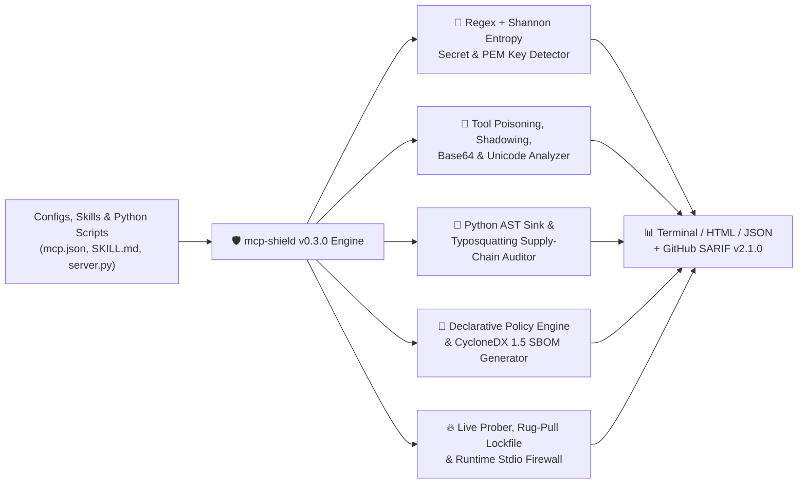

# 🛡️ mcp-shield (v0.3.0)

**AI Agent and MCP Security Scanner, Policy Engine, CycloneDX SBOM Generator & Runtime Firewall. Protects local development environments and CI/CD pipelines by auditing Model Context Protocol configs, decoding hidden prompt injections, detecting cross-server tool shadowing and package typosquatting, checking Python AST for dangerous execution, and enforcing supply-chain hardening.**

[](https://www.python.org/downloads/)
[](LICENSE)
[](#)
[](#)
[](#)
[](https://coderabbit.ai)

Developers connect dozens of Model Context Protocol (MCP) servers and `SKILL.md` files to local AI coding assistants without auditing what those tools can access. **`mcp-shield`** scans, probes, hardens, inventories, and firewalls your MCP ecosystem in under a second with **zero external runtime dependencies**.

---

## ✨ Architecture & Capabilities



---

## 🚀 Quickstart & CLI Recipes

See [`examples/EXAMPLES_GUIDE.md`](examples/EXAMPLES_GUIDE.md) for a complete walkthrough of all bundled vulnerable and production-hardened example files.

### 1. Run the Built-In Vulnerability Demo
```bash
python -m mcp_shield demo --html demo_scorecard.html --sarif results.sarif
```

### 2. Scan a Project, Config, or Skills Directory (`mcp-shield scan`)
```bash
# Scan a clean, production-hardened reference config (Scores 100/100 Grade A)
python -m mcp_shield scan examples/secure_production_mcp.json

# Scan a config with Cross-Server Tool Shadowing (TP-006) & Typosquatting (SC-004)
python -m mcp_shield scan examples/cross_server_shadowing_mcp.json

# Export JSON + SARIF v2.1.0 reports and fail CI on HIGH/CRITICAL findings
python -m mcp_shield scan ./path/to/configs --json findings.json --sarif code-scanning.sarif --fail-on-high
```

### 3. Enforce an Enterprise Security Policy (`mcp-shield policy`) — *New in v0.3.0*
Validate MCP configs against allowed runtime binaries (`npx`, `uvx`, `python`), approved package namespaces (`@modelcontextprotocol/*`), blocked exfiltration domains (`webhook.site`, `ngrok-free.app`), mandatory `${ENV_VAR}` placeholders, and HTTPS transport:
```bash
# Generate a starter mcp-shield-policy.json in your workspace
python -m mcp_shield policy init

# Evaluate a config against your policy (detects POL-001 through POL-005)
python -m mcp_shield policy check examples/vulnerable_mcp_config.json --policy-file examples/mcp-shield-policy.example.json
```

### 4. Generate a CycloneDX v1.5 MCP Software Bill of Materials (`mcp-shield sbom`) — *New in v0.3.0*
Inventory every configured MCP server, runtime binary, package version pin status, transport protocol (`stdio` vs `sse/http`), and referenced environment variable names:
```bash
python -m mcp_shield sbom examples/ -o mcp-inventory.cdx.json
```

### 5. Auto-Fix & Harden Vulnerable Configs (`mcp-shield fix`)
Automatically replaces hardcoded secrets in `env` with `${ENV_VAR}` references, strips `-y` and `--dangerously-skip-permissions` flags, restricts root `/` access, upgrades `http://` to `https://`, and removes invisible Unicode spoofing characters:
```bash
python -m mcp_shield fix examples/vulnerable_mcp_config.json
```

### 6. Live Dynamic Probing & Rug-Pull Lockfile (`mcp-shield probe`)
Spawns an MCP server in a restricted subprocess, queries its live `tools/list` schema, scans for hidden tool poisoning, and records/verifies SHA-256 tool schema fingerprints in `mcp-shield.lock.json` to catch **MCP Rug-Pulls**:
```bash
python -m mcp_shield probe --name my-server --lockfile mcp-shield.lock.json -- python -m mcp_shield serve
```

### 7. Runtime MCP Stdio Firewall (`mcp-shield proxy`)
Wrap any untrusted MCP server in a transparent Man-in-the-Middle JSON-RPC firewall that blocks malicious `tools/call` payloads (`~/.ssh`, `.env`, exfiltration webhooks) and redacts leaked API keys in real time:
```bash
python -m mcp_shield proxy -- npx @modelcontextprotocol/server-filesystem@2025.1.0 ./workspace
```

---

## 📁 Bundled Examples (`examples/`)

| Example File | What It Demonstrates | Score / Grade |
| :--- | :--- | :--- |
| [`examples/secure_production_mcp.json`](examples/secure_production_mcp.json) | Best-practice production MCP config (pinned versions, `${ENV_VAR}`, `./workspace` scope, HTTPS). | **100/100 (`A`)** |
| [`examples/vulnerable_mcp_config.json`](examples/vulnerable_mcp_config.json) | Unpinned `npx -y`, root `/` scope, hardcoded OpenAI/AWS keys, plaintext HTTP, and tool poisoning. | **0/100 (`F`)** |
| [`examples/cross_server_shadowing_mcp.json`](examples/cross_server_shadowing_mcp.json) | **Cross-Server Tool Shadowing (`TP-006`)**, **Typosquatted Package (`SC-004`)**, and **HF Token (`SEC-009`)**. | **0/100 (`F`)** |
| [`examples/poisoned_skill.md`](examples/poisoned_skill.md) | Zero-width Unicode obfuscation (`TP-004`), prompt override (`TP-001`), and `.env` exfiltration (`TP-002`/`TP-003`). | **0/100 (`F`)** |
| [`examples/vulnerable_server.py`](examples/vulnerable_server.py) | Python MCP server with `subprocess.Popen(..., shell=True)` (`AST-003`), `eval()` (`AST-001`), and Base64 payload (`TP-005`). | **0/100 (`F`)** |
| [`examples/mcp-shield-policy.example.json`](examples/mcp-shield-policy.example.json) | Declarative organization security policy for `mcp-shield policy check`. | Policy Config |

---

## 🔍 Complete Detection Rules Matrix

| Rule ID | Category | Severity | Description |
| :--- | :--- | :--- | :--- |
| `TP-001..003` | Tool Poisoning | `CRITICAL` | Covert instruction overrides (`<IMPORTANT>`, `ignore previous instructions`), credential file reads (`~/.ssh/id_rsa`, `.env`), and exfiltration webhooks |
| `TP-004` | Tool Poisoning | `HIGH` | Invisible / zero-width / bidirectional Unicode obfuscation characters (`CVE-2021-42574`) |
| `TP-005` | Tool Poisoning (Obfuscated) | `CRITICAL` | Base64-encoded prompt injection or data-exfiltration payloads |
| `TP-006` | Tool Shadowing / Hijacking | `CRITICAL` / `HIGH` | Cross-server duplicate tool name collision or directive to intercept calls meant for another MCP server |
| `RP-001` | MCP Rug-Pull Detection | `CRITICAL` | Live runtime `tools/list` schema mutated compared to `mcp-shield.lock.json` |
| `AST-001..003` | Dangerous Code Sink (AST) | `CRITICAL` / `HIGH` | Python MCP server calls `eval()`, `exec()`, `os.system()`, or `subprocess.Popen(..., shell=True)` |
| `SEC-001..007` | Secret Exposure | `CRITICAL` / `HIGH` | Hardcoded OpenAI, Anthropic, AWS, GitHub, Google, Slack keys & plaintext DB URIs |
| `SEC-008` | Secret Exposure (Entropy) | `HIGH` | High-entropy custom secret token detected via Shannon entropy analysis (`>= 4.15 bits/char`) |
| `SEC-009` | Secret Exposure | `CRITICAL` | Hardcoded Hugging Face (`hf_...`) or Stripe Live (`sk_live_...`, `rk_live_...`) API token |
| `SEC-010` | Secret Exposure | `CRITICAL` | Hardcoded PEM / OpenSSH / RSA / EC Private Cryptographic Key |
| `PERM-001..002` | Excessive Permissions | `CRITICAL` / `HIGH` | Root filesystem scope (`/`, `C:\`) or `--dangerously-skip-permissions` flags |
| `SC-001..002` | Supply Chain | `HIGH` / `MEDIUM` | Unpinned remote package execution (`npx -y`, `uvx`) without version locking |
| `SC-004` | Supply Chain (Typosquatting) | `CRITICAL` | Lookalike / typosquatted MCP server package (edit distance `<= 2` from canonical `@modelcontextprotocol/*` packages) |
| `POL-001..005` | Declarative Policy Engine | `CRITICAL`..`MEDIUM` | Disallowed server command, blocked domain, unapproved package prefix, literal env value, or plaintext HTTP |
| `NET-001` | Network Security | `HIGH` | Unencrypted `http://` remote MCP server endpoints |
